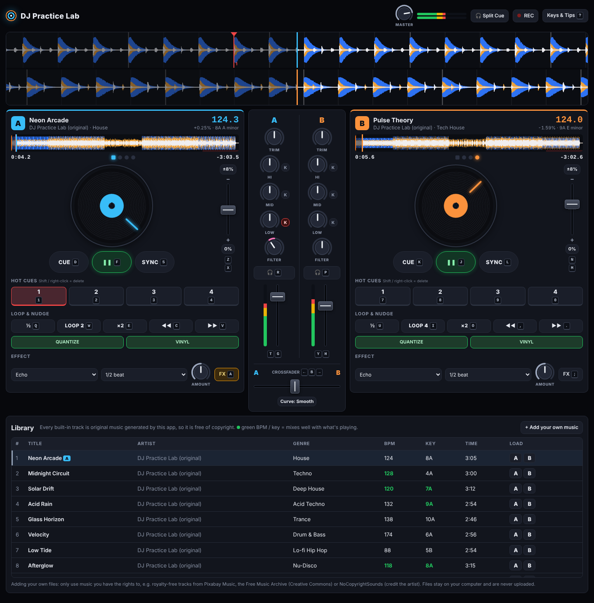

# DJ Practice Lab

A two-deck DJ setup that runs in your browser, for practising mixing. You control it with your **keyboard and mouse**.
All the built-in music is **original and copyright-free**: the app composes and synthesises every track itself, so nothing is sampled from existing recordings.



## Run it

You don't need to install or build anything.

- **Easiest:** open `index.html` in Chrome, Edge, Firefox or Safari.
- **Local server:** run `npm start`, then open <http://localhost:8080>.
- **GitHub Pages:** enable Pages for this repo (Settings → Pages → deploy from branch). The site works as-is.

**New to DJing?** Follow the [step-by-step beginner's guide](guide.html). It's also live at <https://brandontham1993-ux.github.io/DJ-Set/guide.html>.

Click **Start the session**. Deck A loads *Neon Arcade* and deck B loads *Pulse Theory*, ready to mix. Press **?** for every shortcut.
Headphones are recommended.

## On your phone

The app also works in your phone's browser (iPhone Safari, Android Chrome). To get it onto your phone:

1. Host it, e.g. with **GitHub Pages**: Settings → Pages → deploy from your branch.
2. Open that link on the phone. Tap **Share → Add to Home Screen** for a full-screen app.

On a phone:

- **Tabs** under the waveforms switch between **Deck A · Mixer · Deck B · Library**.
- The **bottom bar** always has play, cue, sync and the crossfader for both decks.
- **Gestures:** slide knobs up or down, drag faders, and touch the jog wheel to scratch. Double-tap a knob or fader to reset it. Press and hold a hot cue to delete it.
- **Multi-touch** works: for example, move the crossfader and a volume fader with two fingers at once.
- Turning the phone sideways gives you more room.
- **On iPhone:** use the media volume buttons. The app plays even with the silent switch on, but if you hear nothing, check that Silent Mode is off.

## What you can practise

| Feature | Details |
| --- | --- |
| Two decks | Play/pause, CDJ-style **cue** (set, return, hold to preview), 4 **hot cues**, **SYNC** (tempo + beat, handles half/double time like 87 ↔ 174) |
| Tempo | Pitch fader with ±8 / ±16 / ±50% ranges, fine keyboard steps and **nudge** (pitch bend) for beatmatching by ear |
| Jog wheels | **Vinyl mode** for scratching (forwards and backwards), or pitch-bend mode. You can also drag the big waveform to scratch |
| Loops | Beat-quantized auto loops (½ … 64 beats), halve/double, beat jump |
| Mixer | Trim, 3-band EQ with **kill** switches, one-knob low/high-pass **filter**, channel faders, meters, crossfader (smooth or sharp scratch curve), master |
| Effects | Per-deck Echo (tempo-synced), Reverb, Flanger with an amount knob. Echo and reverb tails ring out naturally when switched off |
| Waveforms | Scrolling three-band colour waveforms with beat grid, phrase bars, cue and loop markers, plus a clickable track overview |
| Headphone cue | **Split Cue** sends the 🎧 channels to your left ear and the master to your right, the way a DJ cues in the booth |
| Recording | Hit **REC** to record your mix and download it as an audio file |
| Library | 9 original tracks (house, techno, deep house, acid, trance, drum & bass, lo-fi, nu-disco, tech house) with BPM and Camelot key. Tracks that mix well with what's playing are highlighted in green |
| Your own music | **+ Add your own music** or drag and drop files. BPM and beat grid are detected automatically. Files never leave your computer |

## Keyboard

| Action | Deck A | Deck B |
| --- | --- | --- |
| Play / pause | `F` | `J` |
| Cue (hold to preview) | `D` | `K` |
| Sync | `S` | `L` |
| Hot cues 1–4 (Shift = delete) | `1` `2` `3` `4` | `7` `8` `9` `0` |
| Loop ½ / on-off / ×2 | `Q` `W` `E` | `U` `I` `O` |
| Kill low / mid / high | `Shift` + `Q` `W` `E` | `Shift` + `U` `I` `O` |
| Tempo − / + | `Z` `X` | `N` `M` |
| Filter sweep | `Shift` + `Z` `X` | `Shift` + `N` `M` |
| Nudge slower / faster (hold) | `C` `V` | `,` `.` |
| Beat jump −4 / +4 | `Shift` + `C` `V` | `Shift` + `,` `.` |
| Volume up / down | `T` `G` | `Y` `H` |
| Effect on / off | `A` | `;` |
| Headphone cue | `R` | `P` |

Global keys:
- `←` / `→`: crossfader (with Shift, slam it to one side)
- `B`: centre the crossfader
- `↑` / `↓`: browse the library
- `[` / `]`: load the selected track to deck A / B
- `?`: show the help

## Mouse

- **Knobs:** drag up or down, or scroll. Double-click resets. Hold Shift for fine control.
- **Faders:** drag, click the track or scroll. Double-click resets.
- **Jog wheel:** grab it to scratch (vinyl mode), or spin it to nudge.
- **Waveforms:** drag the big waveform to scratch and scroll to zoom. Click the overview to jump.

## About the music

The tracks in `js/synth.js` are composed from code: drum patterns, chord progressions and seeded random melodies, played on Web Audio synthesizers.
Each track has a DJ-friendly arrangement: a 16-bar beat-only intro and outro, a breakdown and a drop.
Because the app generates all of it, the music carries no third-party copyright, so you can practise, record and share your mixes freely.

If you add your own files, only use music you have the rights to. Royalty-free sources include Pixabay Music, the Free Music Archive (Creative Commons) and NoCopyrightSounds (credit required).

## Development

```
npm test     # unit tests for beat-grid maths, mixer curves, BPM detection
npm start    # local server
```

Code layout:

- `js/util.js`: pure helpers (music theory, curves, beat grid, BPM detection, waveform analysis)
- `js/processor.js`: AudioWorklet turntable (variable speed, reverse, loops)
- `js/synth.js`: procedural track generator and the track catalogue
- `js/engine.js`: decks, mixer, FX, master, split cue, recording
- `js/controls.js`, `js/waveform.js`, `js/app.js`: UI, keyboard map, render loop
